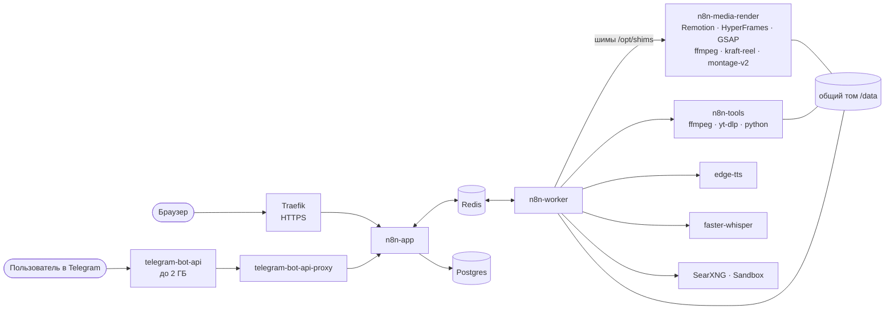

<div align="center">

# 🌌 n8n-BEGET Install

**Production-стек n8n с видео-, карусельными и голосовыми движками, локальным распознаванием речи и Telegram Bot API на 2 ГБ — одной командой на чистый Ubuntu 22.04 / 24.04.**


[Установка](#-установка) · [Ключи Telegram](#-ключи-telegram-bot-api-файлы-до-2-гб) · [Состав](#-что-входит-в-сборку) · [Стили роликов](VIDEO_STYLES.md) · [Сервисы](STACK.md) · [Движки](ENGINES.md) · [История](UPDATE_HISTORY.md)

</div>

> Ветки: `main` — старый универсальный установщик v4, `stack-v2` — актуальная боевая сборка (эта). Слияние `stack-v2` → `main` — решение владельца; до него ставим из `stack-v2`.

---

## ⚡ Установка

```bash
bash <(curl -s https://raw.githubusercontent.com/kalininlive/n8n-beget-install/stack-v2/install.sh)
```

<p align="center"></p>

Установщик задаёт вопросы в 4 шага: **домен и SSL** → **секреты n8n** (можно сгенерировать) → **Telegram** (бот + ключи Bot API) → **прокси** (можно пропустить). Дальше всё сам: Docker → клон репо в `/opt/n8n-install` → `.env` → `install-extras.sh` → `docker compose build && up -d` → cron → проверка.

**Что подготовить заранее**

| Что | Где взять | Обязательно |
|---|---|---|
| Сервер Ubuntu 22.04/24.04, root, от 4 ГБ RAM (8 ГБ — комфортно для рендера) | любой VPS | ✅ |
| Домен, A-запись → IP сервера | панель регистратора | ✅ |
| Токен бота | [@BotFather](https://t.me/BotFather) → `/newbot` | ✅ |
| Ваш Telegram ID | [@userinfobot](https://t.me/userinfobot) | ✅ |
| `api_id` + `api_hash` | [my.telegram.org](https://my.telegram.org) — см. ниже | желательно (иначе лимит 20 МБ) |
| HTTP-прокси | ваш провайдер | нет |

Без вопросов (CI / повторная установка) — задайте ответы переменными:

```bash
DOMAIN=n8n.example.com EMAIL=me@example.com TG_BOT_TOKEN=… TG_USER_ID=… \
TELEGRAM_API_ID=… TELEGRAM_API_HASH=… bash install.sh
```

### 🔑 Ключи Telegram Bot API (файлы до 2 ГБ)

**Зачем.** Обычный Bot API (`api.telegram.org`) отдаёт боту файлы только **до 20 МБ** и принимает на отправку **до 50 МБ** — видео для монтажа не пролезает. Сборка поднимает **собственный сервер Bot API** (`telegram-bot-api`) прямо на машине, и лимит становится **2 ГБ** в обе стороны. Чтобы такой сервер мог подключиться к Telegram, нужны ключи *приложения* (не бота) — `api_id` и `api_hash`.

<p align="center"></p>

1. Откройте **[my.telegram.org](https://my.telegram.org)**, введите номер телефона — код придёт **в сам Telegram**, не по SMS.
2. Выберите **API development tools**.
3. Заполните форму: *App title* — любое (`n8n-files`), *Short name* — латиница 5–32 символа, *Platform* — `Other`. Нажмите **Create application**.
4. Скопируйте **App api_id** (число) и **App api_hash** (32 символа) — установщик спросит их на шаге 3/4 и проверит формат.

> 🔒 Ключи привязаны к вашему аккаунту: не публикуйте их и не передавайте. Хранятся только в `/opt/n8n-install/.env`.
> Пропустили? Впишите `TELEGRAM_API_ID` / `TELEGRAM_API_HASH` в `.env` и выполните `bash install-extras.sh`.

**После установки** — в n8n в кредах Telegram укажите **Base URL: `http://telegram-bot-api-proxy`**. Большие файлы отправляйте с диска (`file:///data/…`), по URL Telegram берёт только до 20 МБ.

---

## 🗺️ Как устроено



---

## 📦 Что входит в сборку

### Ядро

| Компонент | Версия / образ | Роль |
|---|---|---|
| n8n (`n8n-app` + `n8n-worker`, queue mode) | `n8nio/n8n:latest` (последняя версия; закрепить — `FROM n8nio/n8n:2.x.y` в `Dockerfile.n8n`) + `fs-extra`, `path`, `oauth-1.0a` | оркестрация воркфлоу |
| Postgres | `postgres:15-alpine` | база n8n |
| Redis | `redis:7-alpine` | очередь Bull |
| Traefik | `traefik:v3` (последняя 3.x) | HTTPS (Let's Encrypt), редирект http→https |
| n8n-tools | Alpine 3.20: ffmpeg, yt-dlp, python3, fontconfig | утилиты через шимы |
| n8n-bot | Node 20 + `node-telegram-bot-api` | админ-бот: `/status`, `/logs`, `/backups`, `/update` |

### Движки рендера (контейнер `n8n-media-render`, `Dockerfile.render`)

База: `node:22-bookworm-slim` + системный Chromium + ffmpeg + шрифты (Inter, Noto, Noto Color Emoji, DejaVu, FreeFont, Rubik).

| Библиотека / движок | Версия | Что делает |
|---|---|---|
| **Remotion** (`remotion`, `@remotion/cli`) | 4.0.544 | видео «маскот»: React-композиции 1080×1920 @ 60 fps |
| **HyperFrames** | 0.8.221 — та же, что на компьютере владельца (закреплена в `Dockerfile.render`, автообновление CLI отключено; локально `npx hyperframes@0.8.221`) | HTML → видео; сцены стилей Крафт и MONTAGE v2 |
| **GSAP** | 3.15.1 | анимации в HTML офлайн: `file:///opt/engines/vendor/gsap/gsap.min.js`, в Node — `require('gsap')` |
| **puppeteer-core** | 25.17.0 | движок `html-render` (карусели HTML → PNG, 1080×1350 @2x) |
| **fontkit** | 3.0.0 (в контейнере берётся из HyperFrames) | шрифты в MONTAGE v2 |
| ffmpeg + libass, ffprobe | системные | нарезка, склейка, субтитры, нормализация звука |
| **kraft-reel** | 0.4.0 | стиль «Крафт» + чистка голосовых (`voice-cut`) |
| **montage-v2** | 0.5.4 | гибридный монтаж: говорящая голова + графика, 17 стилей, EDL-нарезка пауз, QA-инспектор |

### Речь и озвучка

| Сервис | Образ | Роль |
|---|---|---|
| `edge-tts` | `travisvn/openai-edge-tts` + наш патч (`edge-tts-custom/`) | бесплатная озвучка + пословные таймкоды (`/v1/audio/speech-with-timestamps`) |
| `faster-whisper` | `ghcr.io/speaches-ai/speaches:0.8.3-cpu` | распознавание речи вместо AssemblyAI; модель — `WHISPER_MODEL` (small / medium / large-v3-turbo); шим `whisper` |
| `audio-prep` (внутри `n8n-media-render`, порт 3387) | `engines/montage-v2/audio-prep-service.mjs` | чистка голоса (Auphonic Free при подтверждённом бесплатном аккаунте, иначе локальный ffmpeg) |

### Telegram

| Сервис | Роль |
|---|---|
| `telegram-bot-api` (`aiogram/telegram-bot-api`) | локальный Bot API: **нужны `TELEGRAM_API_ID` / `TELEGRAM_API_HASH`** (my.telegram.org). Скачивание файлов до 2 ГБ, отправка файлом с диска `file:///data/…` до 2 ГБ |
| `telegram-bot-api-proxy` (nginx) | **Base URL кредов Telegram в n8n: `http://telegram-bot-api-proxy`**; отдаёт файлы по HTTP |
| Админ-бот `n8n-bot` | управление сервером из Telegram, ежедневный бэкап в 02:00 |

> **Лимит файлов.** Ставится по умолчанию (установщик спрашивает ключи — [как получить](#-ключи-telegram-bot-api-файлы-до-2-гб)). Bot API (локальный) принимает и отправляет файлы **до 2 ГБ**; для отправки 2 ГБ нужно слать файл с диска (`file:///data/…`), по URL — только до 20 МБ. Выше 2 ГБ (до 4 ГБ) Telegram позволяет только пользовательскому аккаунту Premium через MTProto (юзер-бот) — в сборку не входит.

### Поиск и AI-инструменты n8n

| Сервис | Роль |
|---|---|
| `searxng` | web-поиск для AI Assistant (JSON API) |
| `sandbox-api` + `sandbox-runner-1` (+ `sandbox-certs`) | code sandbox для AI Assistant (`n8n-sandbox-service` 1.2.0) |

### Сеть и прокси

- `PROXY_URL` в `.env` (пусто — без прокси): HTTP/HTTPS-прокси для n8n, worker, media-render и др.
- `NO_PROXY` — имя каждого внутреннего сервиса **в начало списка**, иначе 502 (правило железное, `install-extras.sh` делает сам).

### Уборка и бэкапы

- `scripts/cleanup_data.sh` — cron ежечасно: файлы Bot API (24 ч), `/data/tg-send` (3 ч), `/data/reels` и `/data/carousel/jobs` (24 ч), `/data/genesis` (3 дня); шим `cleanup-genesis-job` — точечная уборка папки задачи.
- `backup_n8n.sh` + cron 02:00: все workflows и credentials → zip → Telegram (< 50 МБ) или `backups/`.
- `update_n8n.sh`: бэкап → новая версия n8n → пересборка → post-check движков → алерт в Telegram.

---

## 🎬 Стили и путь монтажа роликов

Все стили живут в репо данными/кодом движков и выбираются из меню Telegram-бота. Полная карта — [VIDEO_STYLES.md](VIDEO_STYLES.md). Коротко:

| Путь | Что | Стили |
|---|---|---|
| `engines/kraft-reel/` | ролик без персонажа: бумага, линейный город, окна-приложения; режимы Ручной / Авто / Голос | `kraft` (утверждён), `kraft-night` (черновик) |
| `engines/montage-v2/` | видео спикера → whisper → агент-режиссёр (JSON-план) → validate → render | 17 стилей, формат `expert` |
| studio-engine (Remotion, том `/data/studio-engine`) | маскот-ролики 1080×1920 @ 60 fps | `MascotFactoryReel` |
| `engines/html-render/` | карусели HTML → PNG | 4 стиля карусели (шаблоны вшиты в воркфлоу `mcarousel`) |

Как добавлять цвет / декор / формат / стиль / сцену — [engines/kraft-reel/STYLES.md](engines/kraft-reel/STYLES.md) и [engines/montage-v2/STYLES.md](engines/montage-v2/STYLES.md).

---

## 🔌 Интеграции вне установщика

| Что | Где |
|---|---|
| **GENESIS** (Telegram-бот контент-завода, ~50 воркфлоу) | репо `genesis-n8n`, ставится `moy-n8n: npm run client:genesis`; использует все движки выше |

RSSHub и Дзен-публикатор (`kalininlive/dzen-factory`, приватный репозиторий) в сборку не входят; RSSHub не используется.

---

## ❌ Чего в сборке нет (и что с этим делать)

| Нет | Статус |
|---|---|
| Дзен-публикатор | отдельный приватный репозиторий `dzen-factory`, ставится вручную (его `deploy.sh`) |
| Юзер-бот Telegram для файлов 2–4 ГБ | не входит (Bot API ограничен 2 ГБ); отдельные проекты `City News Hub/userbot` (Telethon), `SpyUserbotWebsansay` (GramJS) |
| studio-engine (проект маскота, ≈1 ГБ) | вне git, на сервере в `data/studio-engine`; план публикации — STACK.md §5 |
| kraft-reel и montage-v2 «запечены в образ» | пока ставятся в том `/data/files/…` командами `deploy:kraft-reel` / `deploy:montage-v2` из `moy-n8n` |

---

## 🔧 Повторный запуск и проверка

Только «экстры» (движки, TTS, поиск, sandbox), идемпотентно:

```bash
cd /opt/n8n-install && bash install-extras.sh          # всё
bash install-extras.sh --check                         # только проверка
```

Если `TELEGRAM_API_ID/HASH` пропустили — впишите их в `.env` и повторите `install-extras.sh`: без них контейнер `telegram-bot-api` не запускается.

---

## 🧱 Правила

1. **На сервере — только движки.** Логика, промпты, HTML-шаблоны — в нодах воркфлоу n8n.
2. **Новые сервисы — только в `docker-compose.override.yml`**, поднимать точечно: `docker compose up -d <service>`.
3. **Новый внутренний хост — сразу в начало `NO_PROXY`**, затем `docker compose up -d n8n n8n-worker`.
4. **Шим = одна строка** `exec docker exec -i <container> <cmd> "$@"` в `shims/`, `chmod +x`.
5. **Секреты только в `.env`** (шаблон `.env.template`); в compose — `${...}`.

Шимы: `ffmpeg`, `ffprobe`, `yt-dlp`, `python`, `python3`, `fc-scan`, `edge-tts`, `whisper`, `remotion`, `hyperframes`, `render-html`, `render-studio-reel`, `kraft-reel`, `montage-v2`, `cleanup-genesis-job`.

---

## 🚀 Обновление и бэкап

```bash
# n8n до последней версии: Telegram /update или
bash update_n8n.sh        # build --pull, тег :latest остаётся
# только движки (n8n не трогается)
docker compose build n8n-media-render && docker compose up -d n8n-media-render
```

Управление с ПК (аудит, бэкап, deploy движков, `npm run doctor`) — проект `moy-n8n`.

---

## 📄 Структура

```
/opt/n8n-install/
├── install.sh, install-extras.sh      # установка / экстры (идемпотентно)
├── docker-compose.yml                 # базовый стек
├── docker-compose.override.yml        # движки и доп. сервисы
├── Dockerfile.n8n / .render / .tools  # образы
├── engines/
│   ├── html-render/                   # HTML → PNG (карусели) + шрифты
│   ├── kraft-reel/                    # Крафт + голос (styles/, skins/, formats/)
│   └── montage-v2/                    # гибридный монтаж (styles/, hyperframes/components, sfx/, fonts/)
├── shims/                             # шимы вызова движков из n8n
├── beget/                             # набор GENESIS для серверов с шаблоном Beget (/opt/beget/n8n)
├── workflows/                         # mcarousel-genesis.json, sync-assets-s3.json
├── docs/img/                          # картинки README
├── edge-tts-custom/, telegram-bot-api/, searxng-settings.yml
├── bot/                               # админ-бот Telegram
├── scripts/                           # cleanup_data.sh, cron_backup.sh
├── update_n8n.sh, backup_n8n.sh
├── .env.template  →  .env             # секреты, не в git
├── data/                              # /data во всех контейнерах (reels/, carousel/jobs/, studio-engine/, files/, genesis/)
└── STACK.md, ENGINES.md, VIDEO_STYLES.md, UPDATE_HISTORY.md
```
