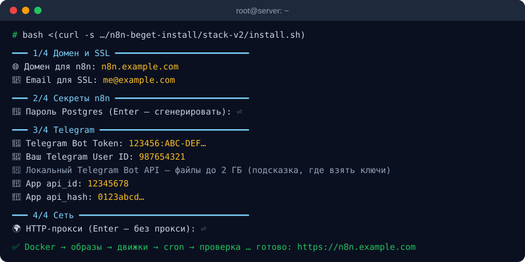
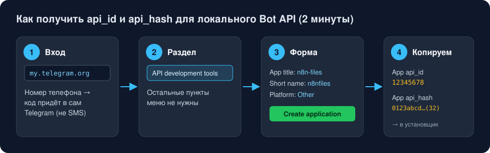
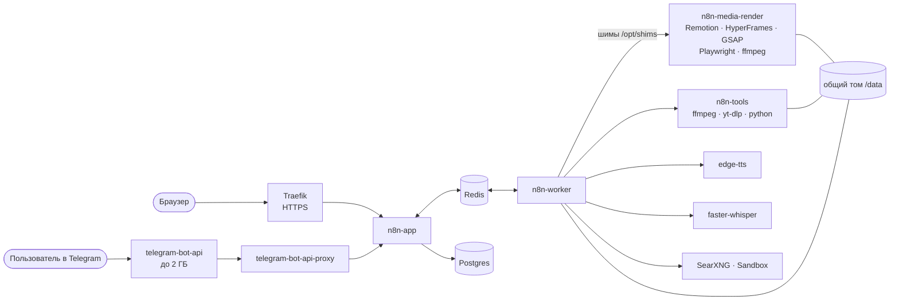

<div align="center">

# 🌌 n8n-BEGET Install

**Боевой стек n8n с видео-, браузерными и голосовыми движками, локальным распознаванием речи и Telegram Bot API на 2 ГБ — одной командой на чистый сервер Ubuntu.**


-E95420?logo=ubuntu&logoColor=white)

[Установка](#-установка) · [Через агента](#-установка-через-ии-агента) · [Ключи Telegram](#-ключи-telegram-bot-api-файлы-до-2-гб) · [Состав](#-что-входит-в-сборку) · [Сервисы](STACK.md) · [Движки](ENGINES.md) · [История](UPDATE_HISTORY.md)

</div>

> Ветки: `main` — старый универсальный установщик v4, `stack-v2` — актуальная боевая сборка (эта). Слияние `stack-v2` → `main` — решение владельца; до него ставим из `stack-v2`.

---

## 🖥️ Требования к серверу

| | Минимум | Рекомендуется |
|---|---|---|
| ОС | Ubuntu **22.04 / 24.04 / 26.04 LTS** (чистая) | **Ubuntu 24.04 LTS** |
| Процессор | 2 vCPU, x86_64 (amd64) | 4+ vCPU |
| Память | 4 ГБ RAM | 8 ГБ RAM |
| Диск | 25 ГБ свободно | 50+ ГБ SSD/NVMe |
| Сеть | публичный IPv4, свободные порты 80 и 443 | — |

> **Какую Ubuntu выбрать?** Берите **24.04 LTS** — на ней сборка работает в бою, поддержка до 2029 года. 22.04 и 26.04 LTS тоже поддерживаются: всё работает в Docker, и от версии ОС почти ничего не зависит. Промежуточные версии (25.10 и т.п.) и ARM-процессоры не подходят: браузер рендера HyperFrames собран только под x86_64. Установщик сам проверит ОС, память, диск, порты и DNS перед началом.

## ⚡ Установка

На сервере под root:

```bash
bash <(curl -fsSL https://raw.githubusercontent.com/kalininlive/n8n-beget-install/stack-v2/install.sh)
```

<p align="center"></p>

Установщик проверяет сервер, затем спрашивает данные в 5 шагов:

1. **Домен и SSL.** Домен для n8n и email для сертификата. Проверяет, что DNS уже указывает на сервер.
2. **Секреты n8n.** Пароль Postgres и ключ шифрования. Нажмите Enter, и они сгенерируются сами.
3. **Админ-бот Telegram.** Токен от @BotFather и ваш ID. Токен проверяется прямо в Telegram.
4. **Telegram Bot API на 2 ГБ.** `api_id` и `api_hash`, с пояснением, где их взять.
5. **Прокси.** Необязательно.

После «Итого» и подтверждения всё дальше идёт само, 10–15 минут: пакеты → swap (если RAM < 8 ГБ) → Docker → код в `/opt/n8n-install` → `.env` → сборка образов → ядро n8n → движки, модели, браузер рендера, шрифты → полная самопроверка → бэкап по cron → сообщение в Telegram.

**Что подготовить заранее**

| Что | Где взять | Обязательно |
|---|---|---|
| VPS по требованиям выше, доступ root по SSH | любой хостинг | ✅ |
| Домен или поддомен, **A-запись → IP сервера** | панель регистратора | ✅ |
| Токен бота | [@BotFather](https://t.me/BotFather) → `/newbot` | ✅ |
| Ваш Telegram ID | [@userinfobot](https://t.me/userinfobot) | ✅ |
| `api_id` + `api_hash` | [my.telegram.org](https://my.telegram.org) — [инструкция](#-ключи-telegram-bot-api-файлы-до-2-гб) | желательно (без них лимит 20 МБ) |
| HTTP-прокси | ваш провайдер | нет |

**После установки**

1. Откройте `https://ваш-домен` и создайте аккаунт владельца n8n.
2. В кредах Telegram в n8n укажите **Base URL: `http://telegram-bot-api-proxy`**.
3. Сохраните `N8N_ENCRYPTION_KEY` из `/opt/n8n-install/.env` в надёжном месте: без него не восстановить креды из бэкапа.

Повторный запуск той же команды безопасен. Он обновит код и сохранит пароли и ключ шифрования из существующего `.env`.

### 🤖 Установка через ИИ-агента

Дайте своему агенту (Claude Code, Codex, Cursor…) с SSH-доступом к серверу такое задание:

```text
Установи мне n8n из репозитория https://github.com/kalininlive/n8n-beget-install (ветка stack-v2)
по инструкции AGENTS.md. Сервер: <IP>, root. Домен: <домен>. Сначала спроси у меня
все недостающие данные одним сообщением, проверь DNS, затем установи и отчитайся
результатом install-extras.sh --check.
```

Агент возьмёт [AGENTS.md](AGENTS.md): там список данных, неинтерактивный запуск (`NONINTERACTIVE=1` + переменные окружения), коды выхода и разбор частых проблем.

Без вопросов вручную (CI, свои скрипты):

```bash
curl -fsSL https://raw.githubusercontent.com/kalininlive/n8n-beget-install/stack-v2/install.sh -o install.sh
DOMAIN=n8n.example.com EMAIL=me@example.com TG_BOT_TOKEN=… TG_USER_ID=… \
TELEGRAM_API_ID=… TELEGRAM_API_HASH=… NONINTERACTIVE=1 bash install.sh
```

### 🔑 Ключи Telegram Bot API (файлы до 2 ГБ)

**Зачем.** Обычный Bot API (`api.telegram.org`) отдаёт боту файлы только **до 20 МБ** и принимает на отправку **до 50 МБ** — видео для монтажа не пролезает. Сборка поднимает **собственный сервер Bot API** (`telegram-bot-api`) прямо на машине, и лимит становится **2 ГБ** в обе стороны. Чтобы такой сервер мог подключиться к Telegram, нужны ключи *приложения* (не бота) — `api_id` и `api_hash`.

<p align="center"></p>

1. Откройте **[my.telegram.org](https://my.telegram.org)**, введите номер телефона — код придёт **в сам Telegram**, не по SMS.
2. Выберите **API development tools**.
3. Заполните форму: *App title* — любое (`n8n-files`), *Short name* — латиница 5–32 символа, *Platform* — `Other`. Нажмите **Create application**.
4. Скопируйте **App api_id** (число) и **App api_hash** (32 символа) — установщик спросит их на шаге 3/4 и проверит формат.

> 🔒 Ключи привязаны к вашему аккаунту: не публикуйте их и не передавайте. Хранятся только в `/opt/n8n-install/.env`.
> Пропустили? Впишите `TELEGRAM_API_ID` / `TELEGRAM_API_HASH` в `.env` и выполните `bash install-extras.sh`.

**После установки** — в n8n в кредах Telegram укажите **Base URL: `http://telegram-bot-api-proxy`**. Большие файлы отправляйте с диска (`file:///data/…`), по URL Telegram берёт только до 20 МБ.

---

## 🗺️ Как устроено



---

## 📦 Что входит в сборку

### Ядро

| Компонент | Версия / образ | Роль |
|---|---|---|
| n8n (`n8n-app` + `n8n-worker`, queue mode) | `n8nio/n8n:latest` (последняя версия; закрепить — `FROM n8nio/n8n:2.x.y` в `Dockerfile.n8n`) + `fs-extra`, `path`, `oauth-1.0a` | оркестрация воркфлоу |
| Postgres | `postgres:15-alpine` | база n8n |
| Redis | `redis:7-alpine` | очередь Bull |
| Traefik | `traefik:v3` (последняя 3.x) | HTTPS (Let's Encrypt), редирект http→https |
| n8n-tools | Alpine 3.20: ffmpeg, yt-dlp, python3, fontconfig | утилиты через шимы |
| n8n-bot | Node 20 + `node-telegram-bot-api` | админ-бот: `/status`, `/logs`, `/backups`, `/update` |

### Движки рендера (контейнер `n8n-media-render`, `Dockerfile.render`)

**Готовый образ** `ghcr.io/kalininlive/n8n-media-render:stack-v2` — его собирает и проверяет GitHub Actions ([workflow](.github/workflows/media-render.yml)), установщик просто скачивает (~1,5 ГБ, на диске ~4 ГБ) параллельно со сборкой ядра. Нет доступа к ghcr.io — образ соберётся на сервере из `Dockerfile.render` (принудительно: `MEDIA_RENDER_BUILD=1`).

Внутри: `node:22-bookworm-slim` + системный Chromium + ffmpeg + коллекция шрифтов `/opt/fonts` + браузер HyperFrames — на сервере ничего не докачивается.

| Библиотека / движок | Версия | Что делает |
|---|---|---|
| **Remotion** (`remotion`, `@remotion/cli`) | 4.0.544 | видео из React-композиций (свои проекты — в томе `/data`) |
| **HyperFrames** | 0.8.221 (закреплена в `Dockerfile.render`, автообновление CLI отключено; локально `npx hyperframes@0.8.221`) | HTML → видео (свои шаблоны и компоненты ставятся отдельно, под себя) |
| **GSAP** | 3.15.1 | анимации в HTML офлайн: `file:///opt/engines/vendor/gsap/gsap.min.js`, в Node — `require('gsap')` |
| **three.js** | 0.187.0 | 3D / WebGL в HTML офлайн: import map на `file:///opt/engines/vendor/three/build/three.module.js` (+ `examples/jsm/`), в Node — `import` из `/usr/local/lib/node_modules/three/build/three.module.js` |
| ffmpeg + libass, ffprobe | системные | нарезка, склейка, субтитры, нормализация звука |
| **Playwright** (Node + Python) | 1.65.1, свой Chromium в `/ms-playwright` | парсинг, скриншоты, автоматизация сайтов: шимы `playwright`, `pw-node`, `pw-python` |

> Движки монтажа (стили роликов, шаблоны и компоненты HyperFrames) в сборку не входят: это индивидуальная настройка, каждый ставит свои в том `/data`.

### 🔤 Шрифты

**62 семейства с кириллицей** (Inter, Montserrat, Unbounded, Golos Text, Manrope, Rubik, Playfair Display, Caveat, JetBrains Mono…), все начертания от тонкого до сверхжирного. В n8n и движках — по пути **`/opt/fonts`**, а Chromium, HyperFrames, Remotion и ffmpeg видят их просто по имени. Каталог для агентов — `/opt/fonts/fonts.json`, свои шрифты — в `fonts/custom/`. Подробно: [fonts/README.md](fonts/README.md).

### Речь и озвучка

| Сервис | Образ | Роль |
|---|---|---|
| `edge-tts` | `travisvn/openai-edge-tts` + наш патч (`edge-tts-custom/`) | бесплатная озвучка + пословные таймкоды (`/v1/audio/speech-with-timestamps`) |
| `faster-whisper` | `ghcr.io/speaches-ai/speaches:0.8.3-cpu` | распознавание речи вместо AssemblyAI; модель — `WHISPER_MODEL` (small / medium / large-v3-turbo); шим `whisper` |

### Telegram

| Сервис | Роль |
|---|---|
| `telegram-bot-api` (`aiogram/telegram-bot-api`) | локальный Bot API: **нужны `TELEGRAM_API_ID` / `TELEGRAM_API_HASH`** (my.telegram.org). Скачивание файлов до 2 ГБ, отправка файлом с диска `file:///data/…` до 2 ГБ |
| `telegram-bot-api-proxy` (nginx) | **Base URL кредов Telegram в n8n: `http://telegram-bot-api-proxy`**; отдаёт файлы по HTTP |
| Админ-бот `n8n-bot` | управление сервером из Telegram, ежедневный бэкап в 02:00 |

> **Лимит файлов.** Ставится по умолчанию (установщик спрашивает ключи — [как получить](#-ключи-telegram-bot-api-файлы-до-2-гб)). Bot API (локальный) принимает и отправляет файлы **до 2 ГБ**; для отправки 2 ГБ нужно слать файл с диска (`file:///data/…`), по URL — только до 20 МБ. Выше 2 ГБ (до 4 ГБ) Telegram позволяет только пользовательскому аккаунту Premium через MTProto (юзер-бот) — в сборку не входит.

### Поиск и AI-инструменты n8n

| Сервис | Роль |
|---|---|
| `searxng` | web-поиск для AI Assistant (JSON API) |
| `sandbox-api` + `sandbox-runner-1` (+ `sandbox-certs`) | code sandbox для AI Assistant (`n8n-sandbox-service` 1.2.0) |

### Сеть и прокси

- `PROXY_URL` в `.env` (пусто — без прокси): HTTP/HTTPS-прокси для n8n, worker, media-render и др.
- `NO_PROXY` — имя каждого внутреннего сервиса **в начало списка**, иначе 502 (правило железное, `install-extras.sh` делает сам).

### Уборка и бэкапы

- `scripts/cleanup_data.sh` — cron ежечасно: файлы Bot API (24 ч), `/data/tg-send` (3 ч), `/data/reels` (24 ч).
- `backup_n8n.sh` + cron 02:00: все workflows и credentials → zip → Telegram (< 50 МБ) или `backups/`.
- `update_n8n.sh`: бэкап → новая версия n8n → пересборка → post-check движков → алерт в Telegram.

---

## ❌ Чего в сборке нет (и что с этим делать)

| Нет | Статус |
|---|---|
| Юзер-бот Telegram для файлов 2–4 ГБ | не входит: Bot API ограничен 2 ГБ, больше — только аккаунт Premium через MTProto (Telethon/GramJS) |
| Воркфлоу, стили роликов, шаблоны HyperFrames, проекты Remotion | индивидуальная настройка: каждый ставит свои поверх готового стека |

---

## 🔧 Повторный запуск и проверка

Только «экстры» (движки, TTS, поиск, sandbox), идемпотентно:

```bash
cd /opt/n8n-install && bash install-extras.sh          # всё
bash install-extras.sh --check                         # только проверка
```

Если `TELEGRAM_API_ID/HASH` пропустили — впишите их в `.env` и повторите `install-extras.sh`: без них контейнер `telegram-bot-api` не запускается.

---

## 🧱 Правила

1. **На сервере — только движки.** Логика, промпты, HTML-шаблоны — в нодах воркфлоу n8n.
2. **Новые сервисы — только в `docker-compose.override.yml`**, поднимать точечно: `docker compose up -d <service>`.
3. **Новый внутренний хост — сразу в начало `NO_PROXY`**, затем `docker compose up -d n8n n8n-worker`.
4. **Шим = одна строка** `exec docker exec -i <container> <cmd> "$@"` в `shims/`, `chmod +x`.
5. **Секреты только в `.env`** (шаблон `.env.template`); в compose — `${...}`.

Шимы: `ffmpeg`, `ffprobe`, `yt-dlp`, `python`, `python3`, `fc-scan`, `edge-tts`, `whisper`, `remotion`, `hyperframes`, `playwright`, `pw-node`, `pw-python`.

---

## 🚀 Обновление и бэкап

```bash
# n8n до последней версии: Telegram /update или
bash update_n8n.sh        # build --pull, тег :latest остаётся
# только движки (n8n не трогается): свежий готовый образ рендера
docker compose pull n8n-media-render && docker compose up -d n8n-media-render
# или своя сборка (после правки Dockerfile.render)
docker compose build n8n-media-render && docker compose up -d n8n-media-render
```

---

## 📄 Структура

```
/opt/n8n-install/
├── install.sh, install-extras.sh      # установка / экстры (идемпотентно)
├── docker-compose.yml                 # базовый стек
├── docker-compose.override.yml        # движки и доп. сервисы
├── Dockerfile.n8n / .render / .tools  # образы
├── shims/                             # шимы вызова движков из n8n
├── docs/img/                          # картинки README
├── fonts/                             # коллекция шрифтов → /opt/fonts (fonts.list в git, файлы — из образа рендера)
├── .github/workflows/                 # сборка и публикация образа n8n-media-render
├── edge-tts-custom/, telegram-bot-api/, searxng-settings.yml
├── bot/                               # админ-бот Telegram
├── scripts/                           # cleanup_data.sh, cron_backup.sh
├── update_n8n.sh, backup_n8n.sh
├── .env.template  →  .env             # секреты, не в git
├── data/                              # /data во всех контейнерах (reels/, files/, tg-send/)
└── STACK.md, ENGINES.md, UPDATE_HISTORY.md
```
